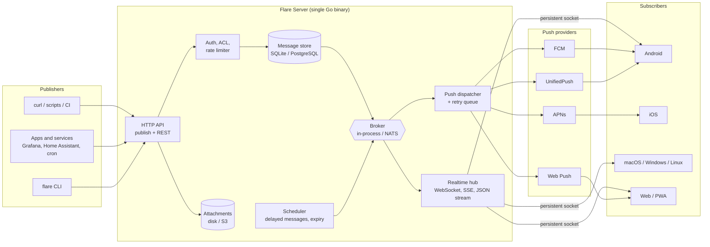
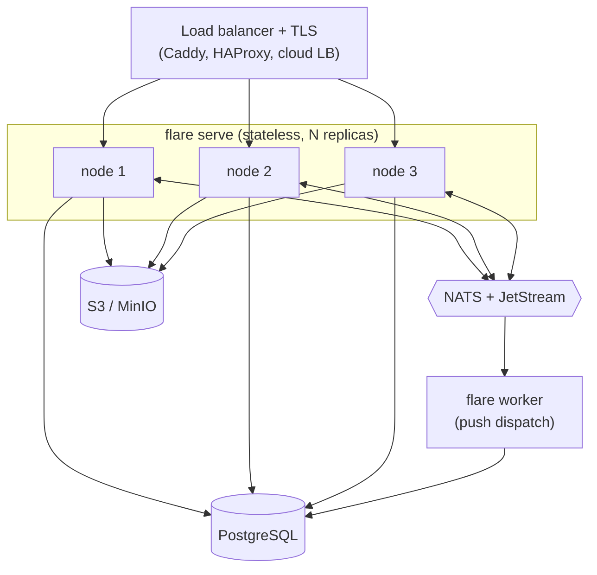
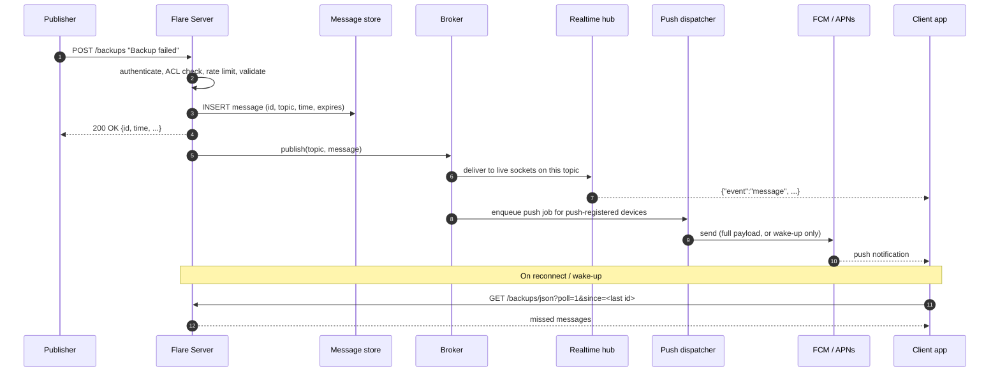
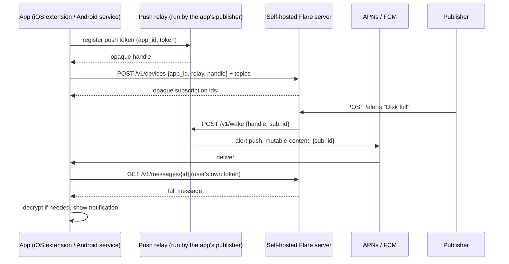
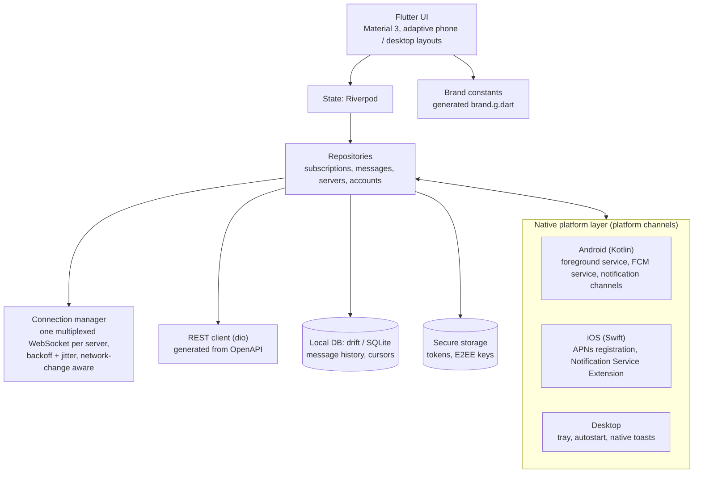
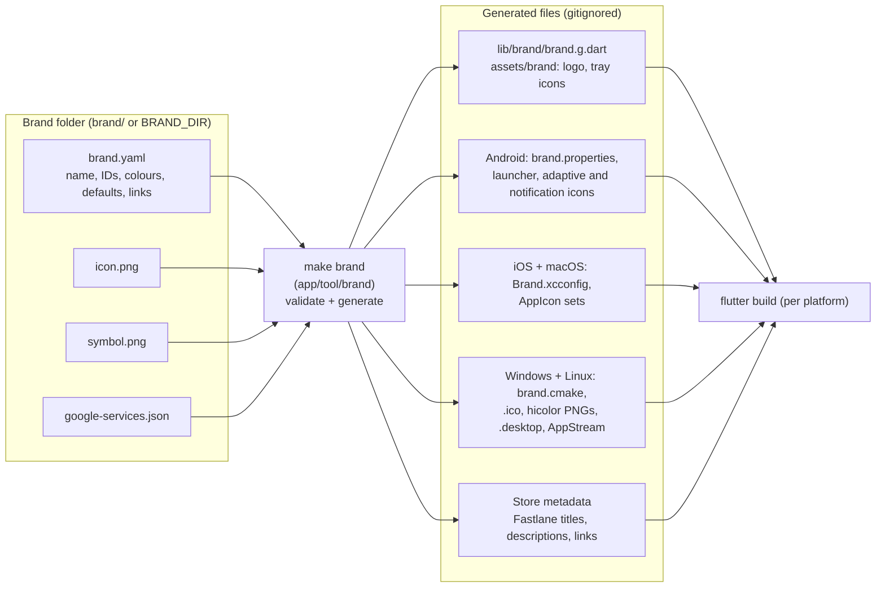

# Flare — Architecture & Tech Stack

Flare is an open-source, self-hostable pub/sub notification and messaging service. A **publisher**
(a script, a server, a CI job, another app, or a person) sends a message to a **topic** over plain
HTTP. A **central server** stores it for a while and forwards it to every **device subscribed** to
that topic, on Linux, Windows, macOS, Android, iOS and the web.

```bash
curl -H "Title: Backup failed" -H "Priority: high" -H "Tags: warning,server-01" \
     -d "rsync exited with code 23" https://flare.example.com/backups
```

That single `curl` line should be all it takes to get a notification onto your phone and desktop.

Anyone can run their own Flare server, and anyone can rebuild the apps under **their own name and
logo** by editing one brand folder (§12). No source changes are needed.

---

## 1. Goals and non-goals

**Goals**

- **Dead-simple publishing**: HTTP `POST`/`PUT` with the message as the body; metadata in headers or
  query parameters, so any tool that can make an HTTP request can publish.
- **Every major OS**: Android, iOS, macOS, Windows, Linux, plus a web/PWA client and a CLI.
- **Reliable delivery**: a message accepted by the server reaches every subscriber at least once, even
  if the device was offline or asleep when it was sent.
- **Open source**: Apache-2.0; everything needed to run, build and publish Flare is in the
  repository; no telemetry; no dependency on any service run by the Flare project.
- **Self-hostable**: one static binary, SQLite by default, no other required services.
- **White-label apps**: app name, logo, colours, identifiers and default server come from a single
  brand folder; rebuilding with a different folder produces a fully rebranded app.
- **Scales out when needed**: the same binary runs as a cluster on PostgreSQL + NATS.
- **Private by design**: access control per topic, optional end-to-end encryption, and push payloads
  that leak nothing to Apple/Google when the user asks for that.

**Non-goals (for v1)**

- Permanent message archive on the server. The server is a *cache* with a TTL; history lives on the
  clients.
- Rich group chat (presence, typing indicators, read receipts). Topics are bidirectional, so simple
  replies work (see §9), but Flare is not trying to be a full chat app.

---

## 2. Core concepts

| Concept | Description |
|---|---|
| **Topic** | A named channel (`backups`, `home-alarm`). Created on first publish unless reserved. Name rules: `[A-Za-z0-9_-]{1,64}`. |
| **Message** | An immutable event on a topic: title, body, priority (1–5), tags, click URL, action buttons, optional attachment, expiry. |
| **Subscription** | A device listening on a topic on a given server. Either *live* (open socket) or *push* (registered for push). |
| **Device** | An installed client. Has an id, platform, `app_id` (which build of the app it is: official or a rebrand), and optionally a push token or relay handle. |
| **User / Token** | Optional accounts. Access tokens (`flr_…`) are used by publishers and clients. |
| **ACL** | Per-user, per-topic-pattern permissions: `read`, `write`, `read-write`, `deny`. |
| **Brand** | The name, logo, identifiers and defaults an app is built with (§12). |

### Message format

```json
{
  "id": "01933c3e-7a4f-7cc1-9b2e-5f1d6a8e4c21",
  "time": 1793318400,
  "expires": 1793404800,
  "event": "message",
  "topic": "backups",
  "title": "Backup failed",
  "message": "rsync exited with code 23",
  "priority": 4,
  "tags": ["warning", "server-01"],
  "click": "https://grafana.example.com/d/backups",
  "actions": [
    { "action": "view", "label": "Open logs", "url": "https://logs.example.com/backup" },
    { "action": "http", "label": "Retry", "url": "https://ci.example.com/retry", "method": "POST" }
  ],
  "attachment": {
    "name": "rsync.log", "type": "text/plain", "size": 10234,
    "url": "https://flare.example.com/v1/files/9f2c….log", "expires": 1793404800
  }
}
```

- `id` is a **UUIDv7** (time-ordered, globally unique, generated by the server).
- `event` is one of `open`, `keepalive`, `message`, `message_deleted`, `poll_request`.
- `priority`: 1 = min, 2 = low, 3 = default, 4 = high, 5 = urgent.

---

## 3. System architecture



### Server components

All components live in one Go binary (`flare serve`). Each one sits behind an interface so the
single-node and cluster implementations can be swapped by configuration.

| Component | Responsibility | Single node | Cluster |
|---|---|---|---|
| **HTTP API** | Publish endpoints, REST (accounts, tokens, topics, devices), file download | `net/http` | same, N replicas |
| **Auth / ACL** | Basic auth + bearer tokens, per-topic ACL, reserved topics | SQLite | PostgreSQL |
| **Rate limiter** | Token buckets per IP and per user (requests, messages/day, bandwidth, subscriptions) | in-memory | in-memory per node; Valkey if limits must be global |
| **Message store** | Persists messages for the cache TTL; serves catch-up (`since=`) queries | SQLite (WAL) | PostgreSQL |
| **Broker** | Fans a stored message out to every node/process that has subscribers for that topic | Go channels | NATS (subject per topic) |
| **Realtime hub** | Holds live connections, maps topic → connections, writes events, sends keepalives | in-process | in-process on each node |
| **Push dispatcher** | Sends to FCM / APNs / Web Push / UnifiedPush or a relay, retries, prunes dead tokens | in-process queue backed by a DB table | NATS JetStream work queue, separate `flare worker` processes |
| **Attachment store** | Stores uploaded files with size quotas and expiry | local disk | S3-compatible (S3, R2, MinIO) |
| **Scheduler** | Releases delayed messages, purges expired messages and attachments | ticker goroutine | same, with a DB-level lease so only one node runs it |
| **Push relay** (mode) | Pushes to an app on behalf of servers that don't hold that app's push keys (§5.3) | `flare relay` | `flare relay` |

### Single-node deployment (default)

```
                 ┌────────────────────────────────────────┐
 Internet ─TLS─▶ │ Caddy (auto HTTPS)  ──▶  flare serve   │
                 │                          ├─ flare.db   │  (SQLite, WAL)
                 │                          └─ files/     │  (attachments)
                 └────────────────────────────────────────┘
```

One VM or Docker container (setup in §13). This is enough for most self-hosters: a Go process holding
idle WebSockets costs tens of KB per connection, so a small VM can hold tens of thousands of
subscribers. Validate the real number with load tests (§11).

### Cluster deployment (scale-out / HA)



- API nodes are stateless; any node can accept a publish, and connections need no sticky sessions.
- On publish, the accepting node writes to PostgreSQL, then publishes to the NATS subject
  `flare.topic.<topic>`. Every node subscribes to the subjects of topics it has live sockets for.
- Push jobs go to a JetStream work queue consumed by `flare worker` replicas, so a slow APNs call never
  blocks the realtime path.

---

## 4. Message flow

### 4.1 Publish → deliver



### 4.2 Delivery guarantees

- **Durable before ack.** The publisher gets `200` only after the message is committed to the store.
- **At-least-once to clients.** Live sockets get the message immediately; anything missed is fetched on
  reconnect with `since=<last seen id>`. Clients **deduplicate by `id`**.
- **No gaps on catch-up.** In a cluster, a message with a slightly earlier timestamp can commit after a
  later one. Catch-up queries therefore re-read a short overlap window (e.g. 10 s before the cursor);
  dedupe makes this free.
- **Ordering.** Per topic by `(time, id)`; clients sort on display.
- **Cache, not archive.** Messages expire after `cache-duration` (default 24 h, per-tier configurable).
  Clients keep their own history in a local database.
- **Push payload size.** FCM and APNs cap payloads at about 4 KB. Small messages are sent in full;
  large or encrypted ones are sent as a `poll_request` (topic + message id) and the app fetches the body.
- **Dead tokens.** APNs `410 Unregistered` / FCM `UNREGISTERED` deletes the device's push token.
  Transient errors retry with exponential backoff and jitter, then give up after the message expires.
- **Push is a queue.** A notification is queued in the same transaction that stores the message, so a
  stored message is never left without its notifications, and a restart loses none. Workers take jobs with
  a lease, so a crash only delays a notification. Before each send the dispatcher asks again whether the
  device's owner may still read the topic.

---

## 5. Platform delivery strategy

Each OS has different rules about what an app may do in the background, and this is the part that
decides the whole client architecture.

| Platform | Primary path | Fallback / alternative | OS notification API |
|---|---|---|---|
| **Android** | FCM high-priority data message (Play Store build) | "Instant delivery" foreground service holding one WebSocket (for de-Googled phones / F-Droid); UnifiedPush | NotificationManager + channels |
| **iOS** | APNs alert push with `mutable-content: 1` + Notification Service Extension | WebSocket only while the app is in the foreground | UserNotifications |
| **macOS** | Menu-bar app with a persistent WebSocket, launched at login | APNs (if distributed through the Mac App Store) | UserNotifications |
| **Windows** | Tray app with a persistent WebSocket, started at login | — | Toast notifications (WinRT) |
| **Linux** | Tray app with a persistent WebSocket, or `flare subscribe` as a systemd user service | — | freedesktop D-Bus notifications |
| **Web / PWA** | Web Push (VAPID) via service worker | WebSocket while the tab is open | Notifications API |

### 5.1 Android

- **Play build:** register an FCM token with the server. The server sends a high-priority *data*
  message; the app's `FirebaseMessagingService` (native Kotlin) shows the notification, or fetches the
  message first if it got a `poll_request`.
- **Instant-delivery mode:** a native Kotlin **foreground service** keeps **one multiplexed WebSocket per
  server** (not one per topic) using OkHttp, with ping/pong keepalives and reconnect-with-backoff on
  network changes. Use foreground-service type `specialUse` (the `dataSync` type is limited to 6 hours a
  day on Android 15+). Ask the user to exempt the app from battery optimisation.
- The always-on path is **native Kotlin, not Dart**: it writes incoming messages into the same SQLite
  database the Flutter UI reads, and posts notifications itself. That keeps memory low and avoids
  booting a Flutter engine in the background.
- One notification channel per priority so users can tune sound and vibration in system settings.
  Request `POST_NOTIFICATIONS` at runtime (Android 13+).

### 5.2 iOS

iOS does not allow long-lived background sockets, so **APNs is the only reliable path**.

- Send a *visible* alert push (placeholder text such as "New message") with `mutable-content: 1`.
  Silent `content-available` pushes are throttled by iOS and are not reliable enough to depend on.
- A **Notification Service Extension** (Swift) wakes up, fetches the full message from the Flare server
  (or decrypts it, see §7), replaces the title and body, downloads an image attachment, and hands
  the notification back. It gets roughly 30 seconds and a tight memory budget, so it only does an
  HTTP fetch and decryption.
- Share credentials and the database between the app and the extension through an **App Group** and
  a shared Keychain access group.
- Map priority to `interruption-level`: 1–2 → `passive`, 3 → `active`, 4–5 → `time-sensitive`.
  `critical` (sounds even on silent) needs a special Apple entitlement; apply for it later if needed.

### 5.3 Push credentials and the push relay

APNs and FCM only accept pushes signed with credentials that belong to the app's publisher: an APNs
key from the Apple team that owns the bundle ID, and a service account from the Firebase project the
Android app was built with. Each rebranded build (§12) has its own identity and its own credentials, so
the server has to know **which app** a device is running before it can push to it.

- Devices register with their `app_id` (Android `applicationId` / Apple bundle ID).
- **Direct push:** if the server holds credentials for that `app_id` (`push.apps` in its config), it
  pushes straight to APNs/FCM.
- **Relay push:** otherwise, if the device registered through a relay that the server allows
  (`push.allowed-relays`), the server sends a content-free wake-up to that relay. The relay is run by
  whoever publishes that app and holds that app's keys. It is the same `flare` binary in `relay` mode.
- **No push:** otherwise the device only gets messages over its live socket and on catch-up.

> **Implemented:** direct push (FCM, APNs), Web Push and UnifiedPush, with the device API of §6. The relay
> is not built yet. The direct senders talk to Google and Apple with plain HTTP clients rather than the
> `firebase.google.com/go` and `apns2` libraries: it is two requests each, and it avoids a large dependency
> tree. FCM and APNs have been tested against fakes of the real services only; neither has been run
> against Google or Apple.



- The self-hosted server never sees the raw push token. The relay never sees the server's topics or
  message content, only an opaque handle, an opaque subscription id and a message id. The app maps the
  subscription id back to a server and topic locally.
- The server only contacts relays on its allow-list, so a device can't make it call arbitrary URLs.
- The relay rate-limits per source IP and per handle; the app can revoke a handle at any time.

**Which setup do I need?**

| You are… | Apps | Push setup |
|---|---|---|
| A self-hoster using the official apps | Official Flare apps | Keep the official relay in `push.allowed-relays` (it is in the sample config) |
| A company with its own branded app for its own server | Rebranded build | Put the app's APNs key and Firebase service account in the server's `push.apps`; no relay |
| The publisher of a public rebranded app used with many servers | Rebranded build | Run `flare relay` with your keys and set `push_relay_url` in `brand.yaml`; server operators add your relay to `push.allowed-relays` |
| Avoiding Google/Apple entirely | Official or rebranded FOSS build | No push provider: Android instant-delivery mode or UnifiedPush, desktop and web sockets. iOS background delivery isn't possible without APNs |

### 5.4 Desktop (macOS, Windows, Linux)

Desktop OSes allow background processes, so the app keeps a persistent WebSocket itself:

- Runs in the system tray / menu bar, starts at login, and shows native notifications.
- Linux tray icons need `libayatana-appindicator`; notifications go through D-Bus.
- For servers and headless machines, the Go CLI does the same job with a tiny footprint:
  `flare subscribe backups --exec 'notify-send "$title" "$message"'`, run as a systemd user service.

### 5.5 Priority mapping

| Flare priority | Android | iOS | Desktop |
|---|---|---|---|
| 1 – min | `IMPORTANCE_MIN`, no sound | `passive` | list only, no toast |
| 2 – low | `IMPORTANCE_LOW` | `passive` | toast, no sound |
| 3 – default | `IMPORTANCE_DEFAULT` | `active` | toast + sound |
| 4 – high | `IMPORTANCE_HIGH` (heads-up) | `time-sensitive` | toast + sound, stays until dismissed |
| 5 – urgent | `IMPORTANCE_HIGH` + long vibration, optional DND bypass | `time-sensitive` (`critical` with entitlement) | persistent, repeated sound |

---

## 6. API design

The publish API is deliberately close to ntfy's, so existing integrations (Grafana, Uptime Kuma,
Home Assistant, shell one-liners) can point at Flare with little or no change. Everything else is
versioned under `/v1`. The contract lives in `api/openapi.yaml` and is the source of truth for
server handlers and generated client code.

### Endpoints

| Method | Path | Purpose |
|---|---|---|
| `POST` / `PUT` | `/{topic}` | Publish. Body = message text (or a file with `PUT`); metadata via headers |
| `POST` | `/v1/messages` | Publish as JSON (topic in body) |
| `GET` | `/v1/ws` | Multiplexed WebSocket: subscribe, unsubscribe and publish on many topics over one socket |
| `GET` | `/{topics}/sse` | Server-Sent Events stream (`topics` = comma-separated list) |
| `GET` | `/{topics}/json` | Newline-delimited JSON stream; `?poll=1` for a one-shot fetch |
| `GET` | `/v1/messages?topic=&since=&limit=` | Paginated history from the cache |
| `GET` | `/v1/messages/{id}` | Fetch one message (used after a push wake-up) |
| `DELETE` | `/v1/messages/{id}` | Retract a message (emits `message_deleted`; not implemented yet) |
| `GET` | `/v1/config` | Public server info: name and logo (runtime branding), API version, feature flags, auth and push modes |
| `POST` | `/v1/devices` | Register a device: `app_id`, platform, provider and its token or endpoint (relay + handle: not yet) |
| `PUT` | `/v1/devices/{id}/subscriptions` | Replace the device's push subscriptions; returns opaque subscription ids. Needs the device secret |
| `DELETE` | `/v1/devices/{id}` | Forget a device. Needs the device secret |
| `POST` | `/v1/auth/login` | Log in with a user name and password (Basic auth); returns an access token |
| `GET` | `/v1/account` | Who the request is logged in as |
| `GET` / `DELETE` | `/v1/account/tokens`, `/v1/account/tokens/{id}` | List and revoke one's own access tokens |
| `PUT` / `DELETE` | `/v1/topics/{topic}` | Reserve a topic, set its ACL |
| `GET` | `/v1/files/{id}` | Download an attachment |
| `POST` | `/v1/handles` | Relay mode only: an app registers its push token and gets a handle |
| `POST` | `/v1/wake` | Relay mode only: a server asks the relay to wake a handle |
| `GET` | `/healthz`, `/readyz`, `/metrics` | Health checks and Prometheus metrics |

**Implemented so far:** publishing (`/{topic}`, `/v1/messages`), the three ways to subscribe, `/v1/config`,
`/healthz` and `/readyz`, accounts (login, access tokens and per-topic access rules, §7), and push
notifications: device registration, subscriptions and fetching one message (§5). The rest arrive with the features they belong to; the authoritative list of what
the server serves today is [`api/openapi.yaml`](../api/openapi.yaml), and a test fails if it and the code
disagree.

### Publish headers

`Title`, `Priority` (`1-5` or `min|low|default|high|urgent`), `Tags`, `Click`, `Icon`, `Actions`,
`Attach` (URL) / `Filename` (with a `PUT` upload), `Delay` (`30m`, `tomorrow 9am`, unix time),
`Markdown`, `Cache: no`. Each header also works as a query parameter (`?title=…`) for tools that cannot
set headers.

Today `Title`, `Priority`, `Tags` and `Click` are supported. The others are **refused with error 40003**
until they are implemented, not silently ignored: dropping `Delay` would send at once a message the
publisher wanted held back.

### WebSocket protocol (`/v1/ws`)

```jsonc
// client → server
{ "op": "auth",        "token": "flr_…" }                       // first frame (browsers can't set WS headers)
{ "op": "subscribe",   "topic": "backups", "since": "01933c3e-…" }
{ "op": "unsubscribe", "topic": "backups" }
{ "op": "publish",     "topic": "chat", "message": "on my way" }

// server → client
{ "event": "subscribed",   "topic": "backups" }                 // live: nothing from now on is missed
{ "event": "unsubscribed", "topic": "backups" }
{ "event": "published",    "topic": "chat", "id": "…" }         // the message was stored (a follower of "chat" also gets it back, before or after this)
{ "event": "message", "topic": "backups", "id": "…", "title": "…", "message": "…" }
{ "event": "error", "code": 40301, "error": "forbidden: no read access to topic", "topic": "backups" }
```

Errors don't close the connection. Error `50002` means a subscription was dropped because the client fell
behind; the client subscribes again with `since` set to the last message it received. On server shutdown
the connection is closed with status 1001 (going away).

A socket starts out anonymous and gets the access of an anonymous visitor. To act as a user, send an `auth`
frame with an access token first, or, for native clients, an `Authorization` header on the upgrade request.
Tokens never go in URLs, because URLs end up in proxy and access logs. A token that is revoked, expired or
belongs to a deleted user ends the connection within 30 seconds (status 1008). A change to the rules that
takes away read access to a topic the socket follows ends that subscription, with a `403` error, in the same
time; the same checks end open `/json` and `/sse` streams.

---

## 7. Security and privacy

- **TLS everywhere.** Caddy (automatic Let's Encrypt) in front of single-node installs; built-in
  `autocert` as an option.
- **Authentication.** Opaque access tokens: `flr_` prefix (so secret scanners can detect leaks) plus 32
  random bytes, stored as a SHA-256 hash. Passwords are hashed with Argon2id, at most four at a time so
  that a flood of logins can't exhaust memory, and a login for a user that doesn't exist costs the same as
  one that does. HTTP Basic auth is accepted for `curl` convenience. A password is needed only to log in:
  a token can't be used to create more tokens, so a stolen token can't outlive its revocation. Credentials
  that are wrong are refused, never treated as an anonymous visitor's. Failed logins are limited to 10 in
  10 minutes per client (an IPv6 client is its /64), with `429` and `Retry-After`.
- **Authorization.** `auth.default-access` (`read-write`, `read-only`, `write-only`, `deny-all`) says what an
  anonymous visitor may do, and what a logged-in user may do where no rule applies. Per-user and
  per-`everyone` rules on topic patterns (`alerts-*`) refine it. Of the rules that match, the most specific
  wins (an exact name, then the longer literal prefix, then the user's own over `everyone`), and at equal
  specificity `deny-all` beats an allow. Administrators may do everything. A refused anonymous visitor gets
  `401` (so a client knows to ask for a login) and a refused user `403`. Anonymous, public topics are
  allowed if the operator enables them; the UI must say clearly that an unreserved topic name is
  effectively a password. Reserving topic names is not implemented yet.
- **Rate limiting and abuse.** Token buckets per IP and per user: request rate, messages per day,
  attachment bandwidth, open subscriptions. Limits come from a `tiers` table so operators can set
  different limits per user group. Only trust `X-Forwarded-For` from configured proxies
(`trusted-proxies`, implemented for the login limit; the other limits are not).
- **Attachments.** Size and total quota limits, expiry, `Content-Disposition: attachment` and
  `X-Content-Type-Options: nosniff`, ideally served from a separate origin to rule out stored XSS.
  The server never fetches external `Attach:` URLs itself (no SSRF); clients do.
- **Push privacy mode.** Per server (`push.content-free`): only send `poll_request` wake-ups, never message
  content, so no push service sees what was published. (Per topic: not yet.) A poll request holds a
  subscription ID and a message ID, and no topic. Without it, a message that fits goes in the notification;
  Web Push is encrypted for the device (RFC 8291), but FCM, APNs and a UnifiedPush distributor can read it.
  Relay wake-ups are always content-free (§5.3).
- **Push endpoints are user-supplied URLs.** The server sends requests to Web Push and UnifiedPush endpoints
  that users register, which is a way to make it send requests into its own network. So it accepts only
  https URLs at public addresses, and checks the address it actually connects to (a name that resolves to a
  private address, including through IPv4-in-IPv6 forms, or changes between lookups, gets nowhere). It
  follows no redirects and uses no proxy for them. `push.allow-private-endpoints` relaxes this for a
  distributor on the same network.
- **Devices.** A device acts with the access of whoever registered it, checked when it follows a topic and
  again before every notification. It is managed with a secret returned once at registration (only a hash
  is kept), sent in the `Device-Secret` header. A server that lets nobody in anonymously refuses anonymous
  devices.
- **Relays.** The server only calls relays on `push.allowed-relays`, so device registrations cannot
  point it at arbitrary URLs.
- **End-to-end encryption (optional, per topic).**
  - The subscribing client generates a random 256-bit key and shares it via a QR code or a link like
    `flare://subscribe/flare.example.com/alerts#key=…` (the scheme comes from the brand). The URL
    fragment is never sent to any server.
  - Message fields (title, body, tags, click, actions, attachment key) are encrypted with
    **AES-256-GCM** into an envelope: `{"enc":"aes256gcm","kid":"…","nonce":"…","ct":"…"}`.
    AES-GCM is chosen because Go's stdlib, Android's `javax.crypto`, Apple's CryptoKit and Dart's
    `cryptography` package all support it natively, so the Kotlin service and the iOS extension can
    decrypt without extra native libraries.
  - `priority` and `topic` stay in plaintext so the server can route and choose push urgency.
  - Attachments are encrypted on the client with a per-file key carried inside the encrypted body.
  - Publishers use `flare publish --key …`, or any library that implements the envelope.
- **Data handling.** Logs never contain message bodies or tokens. Account deletion purges messages,
  tokens, devices and attachments.

---

## 8. Data model

The same schema runs on SQLite and PostgreSQL. Queries are written once in SQL and compiled with
`sqlc`; migrations are managed with `goose`.

| Table | Key columns |
|---|---|
| `users` | `id`, `username`, `password_hash`, `role` (`admin`/`user`), `tier_id`, `created_at` |
| `tokens` | `token_hash` (PK), `user_id`, `label`, `expires_at`, `last_used_at`, `last_ip` |
| `tiers` | `id`, `name`, `messages_per_day`, `cache_duration`, `attachment_quota`, `reserved_topics` |
| `topics` | `name` (PK), `owner_user_id`, `reserved`, `e2ee`, `created_at` |
| `acl` | `user_id` (null = everyone), `topic_pattern`, `permission` |
| `messages` | `id` (UUIDv7, PK), `topic`, `time`, `deliver_at`, `expires_at`, `priority`, `title`, `body`, `tags`, `click`, `actions` (JSON), `attachment_id`, `encoding`, `sender_user_id`, `sender_ip`; index on `(topic, time)` |
| `attachments` | `id`, `message_id`, `name`, `mime`, `size`, `storage_key`, `expires_at` |
| `devices` | `id`, `secret_hash`, `user_id` (null = anonymous), `app_id`, `platform`, `provider`, `target` (push token, endpoint or relay handle), `p256dh`, `auth_secret`, `relay_url`, `app_version`, `created_at`, `seen_at`; unique `(provider, relay_url, target)` |
| `push_subscriptions` | `id` (opaque, sent in notifications), `device_id`, `topic`, `created_at`; unique `(device_id, topic)` |
| `push_jobs` | `id`, `device_id`, `subscription_id`, `message_id`, `attempts`, `next_attempt_at`, `expires_at` |
| `settings` | `key`, `value`: the server's own state, such as its Web Push signing key |
| `devices` | `id`, `secret_hash`, `user_id` (nullable), `app_id`, `platform`, `push_provider`, `push_token` *or* (`relay_url`, `relay_handle`), `app_version`, `last_seen_at` |
| `push_subscriptions` | `id` (opaque, sent in wake-ups), `device_id`, `topic`, `created_at`; unique `(device_id, topic)` |
| `push_jobs` | Single-node queue only: `id`, `device_id`, `message_id`, `attempts`, `next_attempt_at` |

Live socket subscriptions are not stored; they exist only in the realtime hub's memory.

---

## 9. Two-way messaging

Topics are bidirectional pub/sub, so "messaging" mostly falls out of the design: any client with
`write` access can publish to a topic that others read. On top of that:

- A `reply_to` field on messages lets clients render threads.
- A **Reply** action button on notifications publishes back to the same (or a configured) topic, so a
  script can ask "Deploy to prod? [Yes] [No]" and wait for the answer on a reply topic.
- Presence, typing indicators and read receipts are out of scope for v1.

---

## 10. Client architecture (Flutter)



- **One codebase** (Dart/Flutter) for the UI and the business logic on all five OSes.
- **Thin native modules** only where the OS demands it: the Android always-on service and FCM handler
  (Kotlin), the iOS Notification Service Extension and APNs registration (Swift). They share the
  SQLite file (WAL mode) and secure storage with the Flutter side.
- **Brand-neutral code:** the app name, colours, links, URL scheme and default server always come from
  the generated `Brand` class; nothing in the source says "Flare" (§12.6).
- **Multi-server:** a user can subscribe to topics on several servers at once; each server gets its own
  connection and credentials, and is shown with the name and logo from its `/v1/config`.
- **Offline-first:** the UI always reads from the local database; the network layer only writes into it.
- **Deep links:** `<scheme>://subscribe/<host>/<topic>` (plus universal / app links), where `<scheme>`
  comes from the brand, for one-tap subscribe from a QR code.

---

## 11. Recommended tech stack

### Server (Go)

| Concern | Choice | Why |
|---|---|---|
| Language | **Go** 1.25 or newer (CI tests the minimum and the latest) | Cheap goroutine per connection, excellent HTTP stdlib, single static binary that cross-compiles to every OS; ntfy proves Go fits this exact workload |
| HTTP routing | `net/http` (method + path patterns) and a few small middleware of our own | The standard library is enough, so `chi` would only add a dependency |
| WebSocket | `github.com/coder/websocket` | Maintained, context-aware, supports compression |
| SSE / JSON stream | stdlib (`http.ResponseController` flushing) | No dependency needed |
| Embedded DB | SQLite via `modernc.org/sqlite` (pure Go) | No CGO, so cross-compiling stays trivial; WAL mode |
| Server DB | PostgreSQL via `jackc/pgx/v5` | Cluster mode |
| Queries / migrations | `pressly/goose` migrations; plain `database/sql` for now, `sqlc` once there are two dialects | A handful of queries don't need code generation yet; no ORM |
| Broker / queue | in-process channels → **NATS + JetStream** (`nats-io/nats.go`) | One dependency covers cross-node fan-out and the durable push queue |
| APNs | Own thin HTTP/2 + JWT client (`internal/push/apns.go`) | Token-based `.p8` auth; one key per configured app |
| FCM | Own thin HTTP v1 client with service-account OAuth (`internal/push/fcm.go`) | One service account per configured app; no Firebase SDK |
| Web Push | Own implementation of RFC 8291 and 8292 (`internal/push/webpush.go`), standard-library crypto | Checked against the RFC 8291 test vector |
| Attachments | local FS → S3-compatible via `minio-go` | Works with S3, R2, MinIO, Backblaze |
| Auth crypto | `golang.org/x/crypto/argon2`, `crypto/rand`, `crypto/sha256` | |
| Rate limiting | `golang.org/x/time/rate`; Valkey optional for global limits | |
| Config | `gopkg.in/yaml.v3` with strict decoding, then `FLARE_*` environment variables, then flags | Unknown keys are errors, so a typo is never silently ignored |
| Message IDs | Our own UUIDv7 generator | Strictly increasing even within a millisecond, and takes its clock as input, so the "everything after this ID" cursor is exact and testable |
| CLI | `spf13/cobra` | `flare serve / publish / subscribe / user / token / backup / relay / worker` |
| Observability | `log/slog` (JSON), `prometheus/client_golang`, OpenTelemetry | |
| Testing | stdlib `testing`, `testcontainers-go` (PostgreSQL, NATS), **k6** for load tests | Load-test connection counts and publish → delivery latency |
| Release | **GoReleaser** | Binaries for linux/windows/darwin × amd64/arm64, `.deb`/`.rpm`, Homebrew, Scoop/winget, multi-arch Docker images, SBOMs, signatures |
| Packaging | Distroless Docker image, `docker-compose.yml`, Helm chart, systemd unit | |

### Clients

| Concern | Choice |
|---|---|
| Framework | **Flutter** (stable) + Dart, targeting Android, iOS, macOS, Windows, Linux |
| State | `flutter_riverpod` |
| Local DB | `drift` (SQLite) |
| Networking | `dio` (REST, generated from OpenAPI), `web_socket_channel` |
| Secure storage | `flutter_secure_storage` (Keychain, Android Keystore, Windows Credential Manager, libsecret) |
| Notifications | `flutter_local_notifications` (all five platforms) |
| Push | `firebase_messaging` on Android (kept behind an interface so the FOSS build can drop it, §14.5); native Swift APNs registration on iOS |
| UnifiedPush | `unifiedpush` package |
| Desktop shell | `tray_manager`, `window_manager`, `launch_at_startup` |
| E2EE | `cryptography` (+ `cryptography_flutter`); CryptoKit in the iOS extension; `javax.crypto` in the Android service |
| Branding | `tool/brand` generator (Dart: `yaml`, `image`), using `flutter_launcher_icons` and `flutter_native_splash` where they cover a platform (§12) |
| Translations | `flutter_localizations` + ARB files, community translations on Weblate |
| Native code | Kotlin (Android service, FCM handler), Swift (Notification Service Extension) |
| Distribution | Play Store (AAB) + F-Droid / GitHub APK; App Store / TestFlight; notarised DMG (+ Mac App Store); MSIX + winget; Flatpak, AppImage, `.deb` |
| Store automation | Fastlane |

### Web app (optional, phase 2)

TypeScript + React (Vite), embedded in the Go binary with `go:embed` and served by `flare serve`.
It reads its name and logo from `/v1/config`, so operators rebrand it without rebuilding.
Web Push through a service worker (also works for iOS home-screen web apps on iOS 16.4+).

### CI/CD and repository

GitHub Actions: Go lint (`golangci-lint`) and tests, Flutter analyze and tests, builds for every
platform on matching runners (macOS runners for iOS/macOS signing), a test build with an example brand
(§12.6), GoReleaser on tags, Fastlane for the stores, and a reusable workflow that rebranders can call
from their own repository (§12.5).

```
flare/
├── LICENSE  NOTICE  README.md  CHANGELOG.md
├── CONTRIBUTING.md  CODE_OF_CONDUCT.md  SECURITY.md  TRADEMARKS.md  GOVERNANCE.md
├── Makefile                  # make brand | app-<platform> | server | docs
├── api/openapi.yaml          # API contract (source of truth)
├── brand/                    # default (official) brand: brand.yaml, icon.png, symbol.png
│   └── examples/acme/        # test brand, built in CI to prove rebranding works
├── server/                   # Go module: one binary, several modes
│   ├── cmd/flare/            # serve | publish | subscribe   (later: user | token | backup | relay | worker)
│   ├── internal/api/         # HTTP handlers, middleware
│   ├── internal/realtime/    # hub, WebSocket, SSE, JSON stream
│   ├── internal/broker/      # inproc   (later: nats)
│   ├── internal/store/       # sqlite   (later: postgres)
│   ├── internal/message/     # the message model and publishing rules
│   ├── internal/id/          # UUIDv7 message IDs
│   ├── internal/config/      # settings: file, environment, validation
│   ├── internal/client/      # publish and follow, with reconnect and resume
│   ├── internal/server/      # wiring, background purge, graceful shutdown
│   ├── internal/apierr/      # error codes shared by HTTP and WebSocket
│   ├── internal/auth/        # a server-wide access policy   (later: users, tokens, ACL)
│   ├── internal/push/        # (later) apns, fcm, webpush, unifiedpush, relay client + relay server
│   ├── internal/ratelimit/   # (later)
│   ├── internal/attach/      # (later) fs, s3
│   └── migrations/
├── app/                      # Flutter app
│   ├── lib/
│   │   └── brand/brand.g.dart   # generated, gitignored
│   ├── l10n/                 # ARB translation files
│   ├── tool/brand/           # branding generator
│   ├── tool/foss/            # swaps Firebase for a stub in FOSS builds
│   ├── android/              # + Kotlin foreground service, FCM service
│   ├── ios/                  # + NotificationService extension (Swift)
│   └── macos/  windows/  linux/
├── web/                      # optional React PWA
├── deploy/                   # docker-compose.yml, Caddyfile, server.yml sample, Helm chart, systemd
├── docs/
└── .github/                  # CI, reusable build-apps workflow, issue/PR templates, CODEOWNERS
```

The rows for components that are not built yet (NATS, PostgreSQL, the push providers, attachments, rate
limiting) describe the target. [`server/README.md`](../server/README.md) says what exists today.

### Example server configuration

```yaml
# /etc/flare/server.yml
base-url: https://flare.example.com
listen: ":8080"
database: sqlite:///var/lib/flare/flare.db      # or postgres://flare@db/flare
cache-duration: 24h

auth:
  default-access: deny-all                     # read-write | read-only | write-only | deny-all

attachments:
  store: file:///var/lib/flare/attachments      # or s3://bucket/prefix
  max-file-size: 15MB
  total-quota: 5GB
  expiry: 3h

# Runtime branding for the web app, PWA manifest, favicon and "open in app" links (no rebuild needed)
branding:
  name: Flare
  logo: ""                                     # path to an SVG/PNG; empty = built-in logo
  primary-color: "#F97316"
  app-url-scheme: flare                        # must match the url_scheme of the app your users install

push:
  enabled: true
  content-free: false                          # never put message content in a push
  web-push: true
  unified-push: true
  # vapid-subject: mailto:admin@example.com    # defaults to base-url
  allow-private-endpoints: false               # for a UnifiedPush distributor on your network
  # Direct push for apps whose keys you hold (your own rebranded build):
  # apps:
  #   - app-id: com.acme.alerts
  #     fcm-credentials: /etc/flare/acme-fcm-service-account.json
  #     apns-key: /etc/flare/AuthKey_ABC123.p8
  #     apns-key-id: ABC123
  #     apns-team-id: TEAM123
  #     apns-sandbox: false
  # Not implemented yet: relays allowed to wake other apps. The official relay will
  # serve the official apps; remove it if you don't use them.
  # allowed-relays:
  #   - https://push.flare.example

cluster:
  # nats-url: nats://nats:4222                 # set to enable cluster mode
```

---

## 12. White-label builds (custom app name and logo)

Anyone can produce a fully rebranded Flare app (name, logo, colours, identifiers, default server)
by pointing the build at a different **brand folder**. No source file is edited, so a rebrand can
follow upstream releases with a plain `git pull` and a rebuild.

### 12.1 What can be branded, and when

| Part | Branded at | How |
|---|---|---|
| Mobile and desktop apps | **build time** | Brand folder → generator → `flutter build` (name, icons and IDs are baked into each app package) |
| Server web app, PWA manifest, favicon | **runtime** | `branding:` in `server.yml`, served via `/v1/config` |
| Server name shown inside apps | **runtime** | Apps show each server's name and logo from `/v1/config`, next to (never instead of) the app's own branding |
| Server binary and CLI | not branded | Stays `flare`; it's infrastructure, not something end users see |

### 12.2 The brand folder

```
brand/                       # or any folder, passed as BRAND_DIR=/path/to/acme-brand
├── brand.yaml
├── icon.png                 # 1024×1024 square artwork, kept inside the central two thirds
├── symbol.png               # one-colour silhouette on a transparent background, square, ≥ 256 px
├── source/                  # optional: editable SVG sources of the two images (the generator ignores it)
└── firebase/
    └── google-services.json # from your Firebase project (omit for FOSS-only builds)
```

```yaml
# brand.yaml: everything that makes a build "yours" (shortened; brand/README.md explains every field).
schema: 1

app:
  name: Flare                          # launcher label, window title, notifications, About screen (≤ 30 characters)
  short_name: Flare                    # ≤ 12 characters: Android launcher label
  description: Push notifications for your scripts, servers and apps.   # ≤ 80 characters
  url_scheme: flare                    # <scheme>://subscribe/<host>/<topic>
  app_links_domain: ""                 # optional: Universal Links / Android App Links host

ids:                                   # MUST be unique for any build you distribute (§12.4)
  android: com.example.flare           # applicationId
  apple: com.example.flare             # iOS + macOS bundle ID; extension = <id>.NotificationService
  apple_team_id: "ABCDE12345"
  windows: Example.Flare               # MSIX identity name
  windows_publisher: "CN=Example"      # must match your code-signing certificate's subject
  linux: com.example.Flare             # .desktop file, AppStream and Flatpak ID

look:
  icon: icon.png
  symbol: symbol.png                   # source for notification, tray and menu-bar icons
  icon_background: "#0F172A"           # drawn behind the artwork wherever a platform needs an opaque or rounded tile
  primary_color: "#F97316"             # the app's main colour

defaults:
  server_url: https://flare.example.com   # pre-filled server ("" = the user enters one)
  allow_custom_servers: true              # false = app locked to server_url (internal company builds)
  push_relay_url: https://push.flare.example   # your relay (§5.3), or "" if your servers push directly

links:                                 # shown in Settings / About and the store listings
  website: https://example.com
  support: https://example.com/support
  privacy_policy: https://example.com/privacy   # required by the app stores
  source_code: https://github.com/example/flare

firebase:
  android_config: firebase/google-services.json   # "" = no FCM push on Android
```

**Image rules.** `icon.png` is the logo artwork on a transparent background (or a full-bleed opaque
image) with everything that matters inside the central two thirds, because Android crops adaptive icons
to a circle or squircle. `symbol.png` contributes only its shape (its alpha channel), so that notification
and tray icons can be drawn in the single colour each platform requires; the generator trims it to the
shape and adds the padding each platform needs.

The upstream repository's `brand/` folder holds the official Flare brand. Until the project registers
real identifiers, its IDs are placeholders (`com.example.*`), and it leaves `server_url`,
`push_relay_url` and `privacy_policy` empty. `make brand RELEASE=1` refuses placeholders and a missing
privacy policy, so none of that can ship by accident. Every field is documented in
[`brand/README.md`](../brand/README.md).

### 12.3 How a branded build works



The generator ([`app/tool/brand`](../app/tool/brand/README.md)) exists and is tested. The native
projects that read its output are created with the Flutter app (Phase 1) and wired to it once; after
that, neither upstream nor a rebrand ever edits them to change the brand:

| Platform | Generated (gitignored) | Wired into |
|---|---|---|
| All (Dart) | `lib/brand/brand.g.dart`: name, colours, links, URL scheme, default server, relay URL, push identities | UI, theme, settings, About screen |
| Images the app loads | `assets/brand/`: `logo.png`, `tray_linux.png`, `tray_macos_template.png`, `tray_windows.ico` | About screen, system tray |
| Android | `android/brand.properties`; `android/app/src/brand/res/`: launcher, adaptive, monochrome and notification icons, colours; `google-services.json` | `build.gradle.kts` reads `applicationId`, sets the app label with `resValue` and the URL scheme with `manifestPlaceholders`, and adds the `brand/res` folder as a resource directory. The Kotlin package (`namespace`) never changes, so no source files move |
| iOS | `ios/Flutter/Brand.xcconfig`; `AppIcon.appiconset` | `PRODUCT_BUNDLE_IDENTIFIER`, `DEVELOPMENT_TEAM` and display name; Info.plist and entitlements use `$(BRAND_…)` variables for the URL scheme, App Group (`group.<bundle id>`) and keychain group; the extension's ID is `<bundle id>.NotificationService` |
| macOS | `macos/Runner/Configs/Brand.xcconfig`; `AppIcon.appiconset` | same as iOS |
| Windows | `windows/brand.cmake`; `windows/runner/resources/app_icon.ico` | `BINARY_NAME` and version-resource strings; the MSIX identity and publisher are available for packaging |
| Linux | `linux/brand.cmake`; `linux/brand/`: `<id>.desktop` (with the URL-scheme handler), `<id>.metainfo.xml`, hicolor PNG icons | `BINARY_NAME` and `APPLICATION_ID` in `CMakeLists.txt`; the Flatpak manifest is written when Linux packaging is set up |
| Store listings | `fastlane/metadata/`: title, short description, name and the privacy, support and website URLs | Fastlane (full descriptions, screenshots and release notes stay hand-written) |

The generator derives every size from the two images, one recipe per platform. The iOS icon is the
artwork on `icon_background`, square and without an alpha channel, because the App Store rejects icons
with transparency. The macOS icon is an inset rounded tile, as macOS expects. Windows, Linux, the
in-app logo and the legacy Android icon use a full-size rounded tile. The Android adaptive icon uses the
artwork as its foreground over `icon_background`, plus a monochrome layer for themed icons. The Android
notification icon and Linux tray icon are white silhouettes and the macOS menu-bar icon is a black
template image.

The generator owns a fixed list of files and folders (and `.gitignore` is tested to match it). It empties
them before every run, so switching brands never leaves the previous brand's files behind, and it never
touches anything else.

### 12.4 Identity that must be yours

| Item | Why it must be unique | Comes from |
|---|---|---|
| Android `applicationId` | Android and Google Play treat it as the app's identity | `brand.yaml` |
| Apple bundle ID + Team ID | App Store identity; APNs tokens are tied to it | `brand.yaml` + your Apple Developer account |
| App Group, keychain group | Must belong to your Apple team | derived from the bundle ID |
| URL scheme | Two installed apps claiming the same scheme would fight over subscribe links | `brand.yaml` |
| Firebase project | FCM tokens are tied to it | `google-services.json` in the brand folder |
| APNs key, FCM service account | The server or your relay needs them to push to your app | server `push.apps` or your relay's config. **Secret, never in the brand folder** |
| Signing keys (Android keystore, Apple certificates, Windows certificate) | Prove the build is yours | CI secrets or your local keychain. **Never in the brand folder** |

### 12.5 Rebranding in practice

```bash
git clone https://github.com/vignesh-ramsh/flare && cd flare
cp -r brand ../acme-brand                         # start from the default brand
$EDITOR ../acme-brand/brand.yaml                  # name, IDs, colours, default server
cp ~/acme/icon.png ~/acme/symbol.png ../acme-brand/
make brand BRAND_DIR=../acme-brand                # validate and generate the branding files
make brand BRAND_DIR=../acme-brand RELEASE=1      # before a release: refuses placeholder IDs and URLs
# make app-android app-linux BRAND_DIR=../acme-brand   (build targets arrive with the Flutter app)
```

- Keep the brand folder in a separate (even private) repository; it is the only thing a rebrand owns.
- To update: check out a newer upstream tag and run the same `make` commands.
- Rebranders who don't want to set up five build machines can call the upstream **reusable GitHub
  Actions workflow** (`.github/workflows/build-apps.yml`, `workflow_call`) from their own repository,
  passing the brand folder and signing secrets.
- For push, configure the server or a relay with the app's keys (§5.3).

### 12.6 Keeping rebranding working

- **Validation before build.** The generator checks name lengths and characters, ID formats for each
  platform, colours, URLs, image formats and sizes, that `symbol.png` has a transparent background (a
  solid image would show as a plain square in notifications), that `google-services.json` really is for
  the app registered under `ids.android`, that files stay inside the brand folder, and that no key is
  misspelled. It reports every problem at once, with the field name, and generates nothing until they
  are fixed. With `--release` (`make brand RELEASE=1`) it also refuses placeholder identifiers and
  addresses and a missing `privacy_policy`.
- **No hard-coded brand.** UI code reads `Brand.name`; translated strings use an `{appName}`
  placeholder. A CI test fails if the word "Flare" appears in `app/lib` (outside `lib/brand/`) or in
  any `.arb` file.
- **Example brand in CI.** Every pull request generates the files for both the official brand and
  `brand/examples/acme`, checks the outputs (icon sizes, no alpha channel on iOS icons, valid Dart,
  nothing from the other brand left over), and a test asserts that the Acme output contains no trace of
  the name "Flare" except the attribution constants. Once the Flutter app exists, CI also builds it with
  the Acme brand.
- **Identity mix-ups.** The generator warns when a release build uses the upstream identifiers under
  a different name, because the stores would reject it and push notifications are tied to them, and when
  a build uses the name "Flare" with its own identifiers, because that would break the trademark policy
  (§14.2).
- **Attribution stays.** The About screen always says "Based on Flare" and the licences page includes
  Flare's `LICENSE` and `NOTICE`. This is not configurable (`Brand.upstreamName` and `Brand.upstreamUrl`
  are fixed by the generator, and `brand.yaml` rejects a key that tries to set them); it is how rebranded
  builds meet the Apache-2.0 notice requirement.

---

## 13. Self-hosting

### 13.1 Quick start (Docker Compose)

[`deploy/`](../deploy/) has a Compose file, a Caddyfile and a sample `server.yml`. Put your domain in the
Caddyfile and in `server.yml` (`base-url`), point its DNS at the machine, and:

```bash
docker compose -f deploy/docker-compose.yml up -d
```

Caddy gets and renews the HTTPS certificate by itself. Its configuration turns response buffering off,
which streams and WebSockets need. Until released images are published, the Compose file builds the image
from the source. The image is a static binary on a distroless base, runs as an unprivileged user, and keeps
its data in the `/var/lib/flare` volume.

The sample `server.yml` starts with `auth.default-access: deny-all`, so nobody can do anything until
you create a user. The `flare user`, `flare access` and `flare token` commands work on the database
directly, and take effect at once on a running server:

```bash
docker compose -f deploy/docker-compose.yml exec flare flare user add --admin alice
docker compose -f deploy/docker-compose.yml exec flare flare user add bob
docker compose -f deploy/docker-compose.yml exec flare flare access grant bob 'alerts-*' read-write
docker compose -f deploy/docker-compose.yml exec flare flare token add --label backup-server bob
```

The last command prints a token to put in the script that publishes (`FLARE_TOKEN` or
`Authorization: Bearer …`). Users get their own tokens with `flare login`. `trusted-proxies` in the sample
names the Docker network that Caddy reaches the server over; see the comment there.

### 13.2 Other ways to install

- **Binary + systemd:** `.deb`/`.rpm` packages or a plain binary from GitHub Releases, with the sample
  unit file in `deploy/`.
- **Kubernetes:** Helm chart in `deploy/helm` (cluster mode with PostgreSQL + NATS).
- **Behind nginx** instead of Caddy, streaming needs explicit settings:

```nginx
location / {
    proxy_pass http://127.0.0.1:8080;
    proxy_http_version 1.1;
    proxy_set_header Upgrade $http_upgrade;     # WebSocket
    proxy_set_header Connection "upgrade";
    proxy_set_header Host $host;
    proxy_set_header X-Forwarded-For $proxy_add_x_forwarded_for;
    proxy_buffering off;                        # SSE / JSON streams
    proxy_read_timeout 3h;                      # long-lived subscriptions
}
```

### 13.3 Backups and upgrades

- **Backups:** `flare backup <file>` writes a consistent snapshot of the SQLite database while the server
  runs (`VACUUM INTO`); Litestream can replicate it continuously to S3. On PostgreSQL, use `pg_dump` or
  your provider's backups. Attachments are short-lived, so backing them up is optional.
- **Upgrades:** semantic versioning. Upgrades within a major version are drop-in: database migrations run
  automatically at start-up, each in a transaction. Downgrades aren't supported, so back up first.
  Breaking changes only happen in a new major version, with a migration guide.

### 13.4 Version compatibility

Rebranded apps often lag behind upstream releases, so apps and servers of different versions must keep
working together:

- `/v1/config` returns `api_version` and a `features` list (`"attachments"`, `"e2ee"`, …). Clients
  feature-detect instead of comparing version numbers.
- A v1 server accepts every v1 client, and a v1 client works with every v1 server.

### 13.5 Privacy defaults

- No telemetry, analytics, crash reporting or update checks in the server or the upstream apps.
- The server's only outbound calls go to push providers and relays the operator configured
  (`push.apps`, `push.allowed-relays`). The sample config lists the official relay so the official iOS
  app works out of the box; delete that line to turn it off.
- Logs never include message content, and IP logging can be switched off.

---

## 14. Open-source project setup

### 14.1 Licence

**Decision: Apache-2.0 for everything** (server, relay, CLI, apps, web app and build tooling). The
licence text is in [`LICENSE`](../LICENSE) and the copyright notice in [`NOTICE`](../NOTICE); source
files carry SPDX headers ([CONTRIBUTING.md](../CONTRIBUTING.md)). Options that were considered:

| Option | Fit for Flare |
|---|---|
| **Apache-2.0 for everything (chosen)** | Lets anyone self-host, modify and publish rebranded apps, including in app stores and commercially. Includes an explicit patent grant and is the norm for infrastructure projects. Does not force forks to publish their changes. |
| AGPL-3.0 server + Apache-2.0 apps | Anyone running a modified server as a service must publish its source; the apps stay store-friendly. Some companies avoid AGPL software, which can slow adoption. |
| GPL / AGPL for the apps | Not recommended. Copyleft terms are widely considered incompatible with App Store distribution terms, which would stop third parties from publishing rebranded iOS builds. |
| MIT | Simple and permissive, but has no explicit patent grant. |

### 14.2 Trademark policy ([`TRADEMARKS.md`](../TRADEMARKS.md))

The code is open source; the **"Flare" name and logo are not** (Apache-2.0 §6 grants no trademark
rights). This pairs naturally with white-labelling:

- Anyone may build and use the apps, modified or not, for themselves or inside their organisation, and
  may say "based on Flare" or "works with Flare".
- Anyone who **publishes** a modified or rebuilt app (in a store or on a website) must use their own
  name, logo and identifiers. The brand folder makes that a few minutes of work.
- The official push relay serves only the official apps.
- `NOTICE` lists the logo files in `brand/` as excluded from the Apache licence.

### 14.3 Contributions and community

- **DCO, not a CLA:** contributors sign off commits (`git commit -s`), enforced by the DCO GitHub App.
  Under Apache-2.0, contributions are licensed under the same licence ("inbound = outbound").
- **Community files:** `README.md`, `LICENSE`, `NOTICE`, `CONTRIBUTING.md` (dev setup, tests, commit
  style), `CODE_OF_CONDUCT.md` (Contributor Covenant), `SECURITY.md` (report vulnerabilities privately
  through GitHub's private vulnerability reporting), `TRADEMARKS.md`, `GOVERNANCE.md`, issue and PR
  templates, `CODEOWNERS`.
- **Governance:** start with a small maintainer team and write down how decisions are made in
  `GOVERNANCE.md` as the contributor base grows.
- **Changelog:** Conventional Commits, so release notes and `CHANGELOG.md` can be generated.

### 14.4 Releases and supply chain

- Releases are built only in CI from signed tags. GoReleaser produces checksums, SBOMs (Syft) and
  keyless cosign signatures; GitHub artifact attestations record build provenance.
- Multi-arch container images on `ghcr.io`, signed the same way.
- Dependency updates via Renovate or Dependabot. CI licence checks (`go-licenses` for Go,
  `very_good packages check licenses` for Dart) keep every dependency Apache-compatible.

### 14.5 Official distribution channels

- **Server:** GitHub Releases, `ghcr.io`, `.deb`/`.rpm`, Homebrew, Helm.
- **Apps:** GitHub Releases (APK, DMG, MSIX, AppImage), F-Droid, Google Play, App Store, Flathub, winget.
- **F-Droid** only accepts apps without proprietary libraries. The FOSS build swaps the Firebase package
  for a no-op stub at build time (`tool/foss`), because Flutter registers every plugin listed in
  `pubspec.yaml` no matter which Gradle flavour is built. FOSS builds get push through instant-delivery
  mode or UnifiedPush. Android builds should be reproducible so F-Droid can verify them.

### 14.6 Translations and documentation

- Strings live in ARB files; translators contribute through Weblate, which offers free hosting to
  libre projects.
- `docs/` is published as a static site on GitHub Pages: self-hosting guide, configuration reference
  (generated from the config struct), API reference (generated from OpenAPI), and a rebranding guide.

---

## 15. Alternatives considered

### Server language

| Option | Verdict |
|---|---|
| **Go** | **Chosen.** Best balance of connection scalability, development speed, and single-binary self-hosting. |
| Rust (Axum + Tokio) | Lower memory and stronger safety guarantees, but slower to iterate on. A good choice if the team already knows Rust. |
| Elixir / Phoenix | Best-in-class realtime fan-out and clustering, but a smaller hiring pool and a weaker single-binary story for self-hosters. |
| Node.js / TypeScript | Quick to build and shares a language with the web app, but less suited to very many long-lived connections per process and to single-binary distribution. |

### Client framework

| Option | Verdict |
|---|---|
| **Flutter** | **Chosen.** One codebase for all five OSes with mature desktop support and plugins for notifications, tray and secure storage. Branding is a matter of generated config, not code. |
| Kotlin Multiplatform + Compose Multiplatform | Best Android integration and good iOS interop; desktop runs on the JVM (heavier tray app, bundled runtime). Choose it if the team is Kotlin-first. |
| Tauri 2 | Tiny desktop binaries with a web UI, but the mobile background/push story is immature. |
| React Native | No first-class Linux support, so it fails the "all major OS" requirement. |
| Fully native per OS | Best UX, but four to five codebases, and rebranding would have to be done separately in each one. |

---

## 16. Roadmap

**Phase 0 — Foundations**
- Licence, `NOTICE`, community files and trademark policy (done).
- OpenAPI contract, CI pipeline, monorepo layout.
- Branding generator and the example brand **from day one**: brand-neutral code is cheap to keep but
  expensive to retrofit (generator, example brand, tests and CI checks are done; wiring the native
  projects to it comes with the Flutter app).

**Phase 1 — MVP**
- Server, single node: publish, WebSocket/SSE/JSON/poll subscribe, SQLite cache with catch-up, Docker image
  and the Compose self-hosting guide (**done**), users, access tokens and per-topic access rules
(**done**). Still to do: rate limits for publishing, and abuse protection.
- CLI: `flare publish`, `flare subscribe` (**done**).
- Push notifications, server side: device registration, FCM, APNs, Web Push and UnifiedPush, with a durable
  queue and retries (**done**, FCM and APNs only against fakes). Still to do: the relay.
- Android app (FCM + instant-delivery mode) and desktop apps (tray + native notifications).

**Phase 2 — Full platform coverage**
- iOS app with Notification Service Extension; direct push (`push.apps`) and `flare relay`.
- Reusable GitHub Actions workflow for branded builds.
- Attachments, action buttons, scheduled delivery, Markdown, icons.
- Web PWA with Web Push and runtime branding.
- F-Droid FOSS build.

**Phase 3 — Scale and privacy**
- Cluster mode (PostgreSQL + NATS JetStream + `flare worker`).
- End-to-end encrypted topics.
- UnifiedPush distributor support, so other apps (for example Matrix clients) can receive push via Flare.
- Email-to-topic and webhook gateways.

---

## 17. Open questions

1. **Official builds:** will the project publish official apps in the stores and run the official relay?
   That needs an Apple Developer account ($99/year), a Google Play account ($25 one-time) and a small
   server for the relay. Without official builds, every self-hoster who wants iOS push would have to
   build their own branded app.
2. **Is E2EE a launch requirement?** If yes, design the envelope format before the first public release so
   it doesn't need a breaking change.
3. **How much two-way messaging?** Simple replies fit the current design; full chat would add presence,
   receipts and much longer retention.
4. **Team skills.** A Kotlin-heavy team should weigh Kotlin Multiplatform; a Rust-heavy team, Rust for the server.
5. **Name.** Check trademark and app-store availability for "Flare" before publishing anything; the
   trademark policy depends on the project actually being able to use the name.
