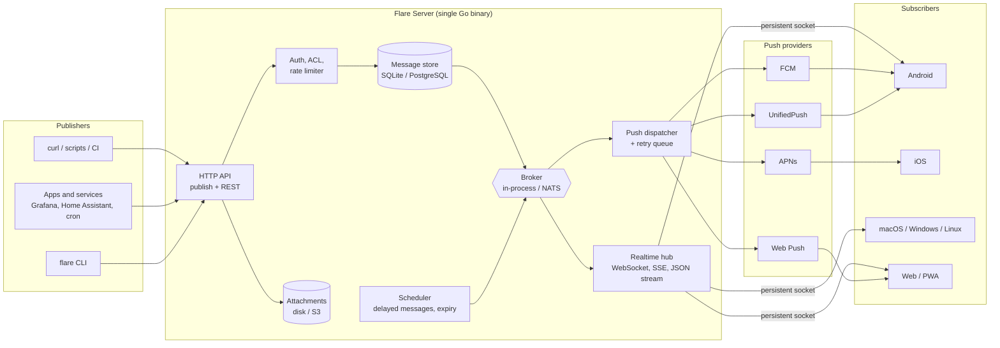
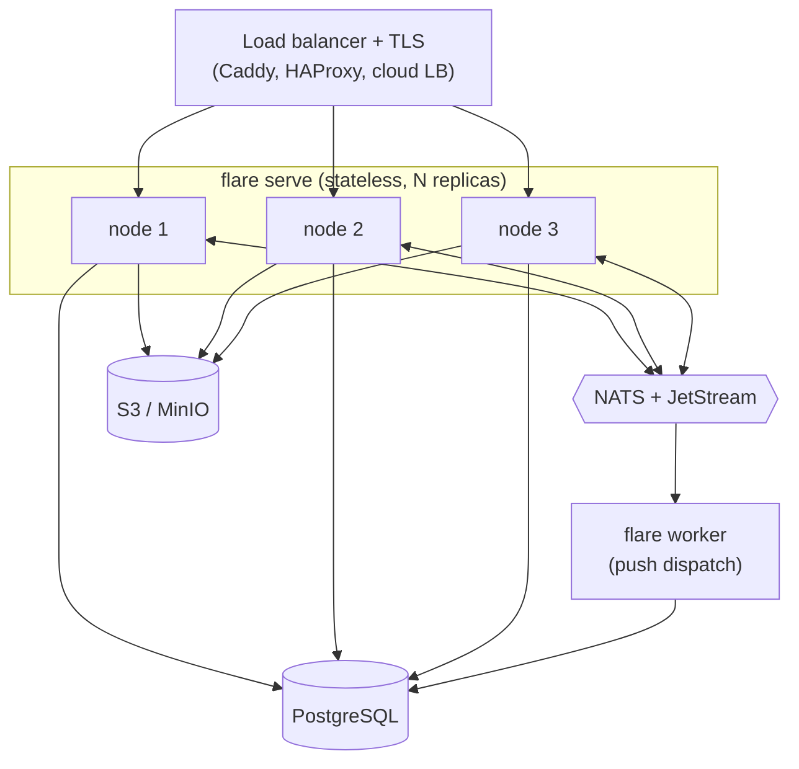
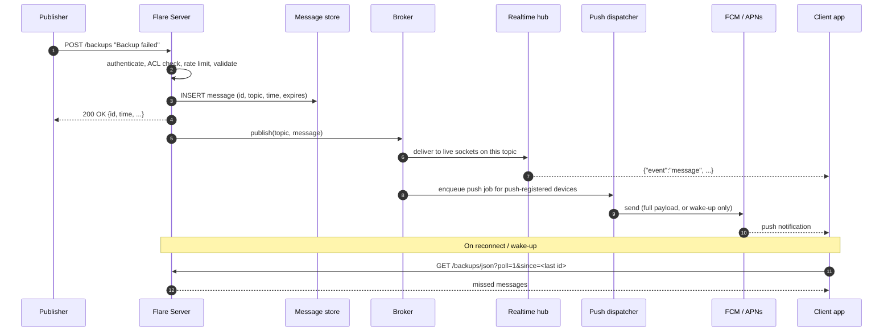
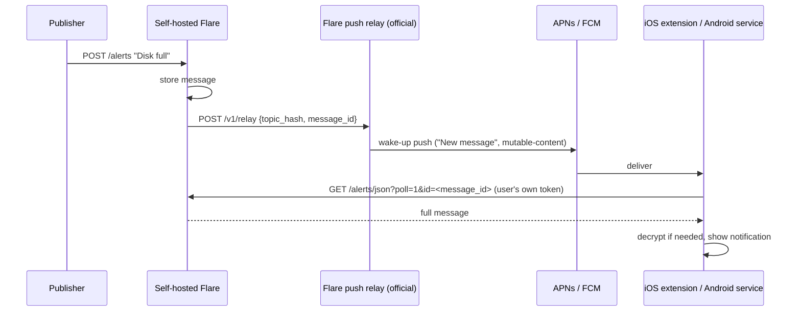
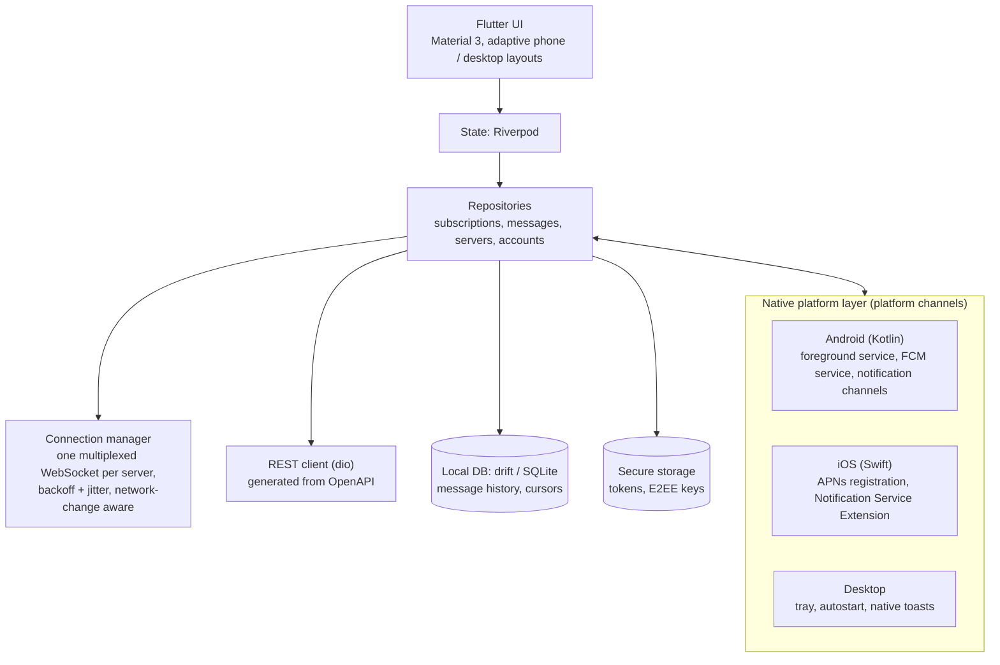

# Flare — Architecture & Tech Stack

Flare is a pub/sub notification and messaging service. A **publisher** (a script, a server, a CI job,
another app, or a person) sends a message to a **topic** over plain HTTP. A **central server** stores
it for a while and forwards it to every **device subscribed** to that topic, on Linux, Windows, macOS,
Android, iOS and the web.

```bash
curl -H "Title: Backup failed" -H "Priority: high" -H "Tags: warning,server-01" \
     -d "rsync exited with code 23" https://flare.example.com/backups
```

That single `curl` line should be all it takes to get a notification onto your phone and desktop.

---

## 1. Goals and non-goals

**Goals**

- **Dead-simple publishing**: HTTP `POST`/`PUT` with the message as the body; metadata in headers or
  query parameters, so any tool that can make an HTTP request can publish.
- **Every major OS**: Android, iOS, macOS, Windows, Linux, plus a web/PWA client and a CLI.
- **Reliable delivery**: a message accepted by the server reaches every subscriber at least once, even
  if the device was offline or asleep when it was sent.
- **Self-hostable**: one static binary, SQLite by default, no other required services.
- **Scales out when needed**: the same binary runs as a cluster on PostgreSQL + NATS.
- **Private by design**: access control per topic, optional end-to-end encryption, and push payloads
  that leak nothing to Apple/Google when the user asks for that.

**Non-goals (for v1)**

- Permanent message archive on the server. The server is a *cache* with a TTL; history lives on the
  clients.
- Rich group chat (presence, typing indicators, read receipts). Topics are bidirectional, so simple
  replies work (see §9), but Flare is not trying to be a full chat app.

---

## 2. Core concepts

| Concept | Description |
|---|---|
| **Topic** | A named channel (`backups`, `home-alarm`). Created on first publish unless reserved. Name rules: `[A-Za-z0-9_-]{1,64}`. |
| **Message** | An immutable event on a topic: title, body, priority (1–5), tags, click URL, action buttons, optional attachment, expiry. |
| **Subscription** | A device listening on a topic on a given server. Either *live* (open socket) or *push* (registered push token). |
| **Device** | An installed client. Has an id, platform, and optionally a push token (FCM / APNs / Web Push / UnifiedPush). |
| **User / Token** | Optional accounts. Access tokens (`flr_…`) are used by publishers and clients. |
| **ACL** | Per-user, per-topic-pattern permissions: `read`, `write`, `read-write`, `deny`. |

### Message format

```json
{
  "id": "01933c3e-7a4f-7cc1-9b2e-5f1d6a8e4c21",
  "time": 1793318400,
  "expires": 1793404800,
  "event": "message",
  "topic": "backups",
  "title": "Backup failed",
  "message": "rsync exited with code 23",
  "priority": 4,
  "tags": ["warning", "server-01"],
  "click": "https://grafana.example.com/d/backups",
  "actions": [
    { "action": "view", "label": "Open logs", "url": "https://logs.example.com/backup" },
    { "action": "http", "label": "Retry", "url": "https://ci.example.com/retry", "method": "POST" }
  ],
  "attachment": {
    "name": "rsync.log", "type": "text/plain", "size": 10234,
    "url": "https://flare.example.com/v1/files/9f2c….log", "expires": 1793404800
  }
}
```

- `id` is a **UUIDv7** (time-ordered, globally unique, generated by the server).
- `event` is one of `open`, `keepalive`, `message`, `message_deleted`, `poll_request`.
- `priority`: 1 = min, 2 = low, 3 = default, 4 = high, 5 = urgent.

---

## 3. System architecture



### Server components

All components live in one Go binary (`flare serve`). Each one sits behind an interface so the
single-node and cluster implementations can be swapped by configuration.

| Component | Responsibility | Single node | Cluster |
|---|---|---|---|
| **HTTP API** | Publish endpoints, REST (accounts, tokens, topics, devices), file download | `net/http` | same, N replicas |
| **Auth / ACL** | Basic auth + bearer tokens, per-topic ACL, reserved topics | SQLite | PostgreSQL |
| **Rate limiter** | Token buckets per IP and per user (requests, messages/day, bandwidth, subscriptions) | in-memory | in-memory per node; Valkey if limits must be global |
| **Message store** | Persists messages for the cache TTL; serves catch-up (`since=`) queries | SQLite (WAL) | PostgreSQL |
| **Broker** | Fans a stored message out to every node/process that has subscribers for that topic | Go channels | NATS (subject per topic) |
| **Realtime hub** | Holds live connections, maps topic → connections, writes events, sends keepalives | in-process | in-process on each node |
| **Push dispatcher** | Sends to FCM / APNs / Web Push / UnifiedPush, retries, prunes dead tokens | in-process queue backed by a DB table | NATS JetStream work queue, separate `flare worker` processes |
| **Attachment store** | Stores uploaded files with size quotas and expiry | local disk | S3-compatible (S3, R2, MinIO) |
| **Scheduler** | Releases delayed messages, purges expired messages and attachments | ticker goroutine | same, with a DB-level lease so only one node runs it |
| **Push relay** (mode) | Lets self-hosted servers wake the official mobile apps (see §5.3) | `flare relay` | `flare relay` |

### Single-node deployment (default)

```
                 ┌────────────────────────────────────────┐
 Internet ─TLS─▶ │ Caddy (auto HTTPS)  ──▶  flare serve   │
                 │                          ├─ flare.db   │  (SQLite, WAL)
                 │                          └─ files/     │  (attachments)
                 └────────────────────────────────────────┘
```

One VM or Docker container. This is enough for most self-hosters and for the first version of a
hosted service: a Go process holding idle WebSockets costs tens of KB per connection, so a small VM
can hold tens of thousands of subscribers. Validate the real number with load tests (§11).

### Cluster deployment (scale-out / HA)



- API nodes are stateless; any node can accept a publish, and connections need no sticky sessions.
- On publish, the accepting node writes to PostgreSQL, then publishes to the NATS subject
  `flare.topic.<topic>`. Every node subscribes to the subjects of topics it has live sockets for.
- Push jobs go to a JetStream work queue consumed by `flare worker` replicas, so a slow APNs call never
  blocks the realtime path.

---

## 4. Message flow

### 4.1 Publish → deliver



### 4.2 Delivery guarantees

- **Durable before ack.** The publisher gets `200` only after the message is committed to the store.
- **At-least-once to clients.** Live sockets get the message immediately; anything missed is fetched on
  reconnect with `since=<last seen id>`. Clients **deduplicate by `id`**.
- **No gaps on catch-up.** In a cluster, a message with a slightly earlier timestamp can commit after a
  later one. Catch-up queries therefore re-read a short overlap window (e.g. 10 s before the cursor);
  dedupe makes this free.
- **Ordering.** Per topic by `(time, id)`; clients sort on display.
- **Cache, not archive.** Messages expire after `cache-duration` (default 24 h, per-tier configurable).
  Clients keep their own history in a local database.
- **Push payload size.** FCM and APNs cap payloads at about 4 KB. Small messages are sent in full;
  large or encrypted ones are sent as a `poll_request` (topic + message id) and the app fetches the body.
- **Dead tokens.** APNs `410 Unregistered` / FCM `UNREGISTERED` deletes the device's push token.
  Transient errors retry with exponential backoff and jitter, then give up after the message expires.

---

## 5. Platform delivery strategy

Each OS has different rules about what an app may do in the background, and this is the part that
decides the whole client architecture.

| Platform | Primary path | Fallback / alternative | OS notification API |
|---|---|---|---|
| **Android** | FCM high-priority data message (Play Store build) | "Instant delivery" foreground service holding one WebSocket (for de-Googled phones / F-Droid); UnifiedPush | NotificationManager + channels |
| **iOS** | APNs alert push with `mutable-content: 1` + Notification Service Extension | WebSocket only while the app is in the foreground | UserNotifications |
| **macOS** | Menu-bar app with a persistent WebSocket, launched at login | APNs (if distributed through the Mac App Store) | UserNotifications |
| **Windows** | Tray app with a persistent WebSocket, started at login | — | Toast notifications (WinRT) |
| **Linux** | Tray app with a persistent WebSocket, or `flare subscribe` as a systemd user service | — | freedesktop D-Bus notifications |
| **Web / PWA** | Web Push (VAPID) via service worker | WebSocket while the tab is open | Notifications API |

### 5.1 Android

- **Play build:** register an FCM token with the server. The server sends a high-priority *data*
  message; the app's `FirebaseMessagingService` (native Kotlin) shows the notification, or fetches the
  message first if it got a `poll_request`.
- **Instant-delivery mode:** a native Kotlin **foreground service** keeps **one multiplexed WebSocket per
  server** (not one per topic) using OkHttp, with ping/pong keepalives and reconnect-with-backoff on
  network changes. Use foreground-service type `specialUse` (the `dataSync` type is limited to 6 hours a
  day on Android 15+). Ask the user to exempt the app from battery optimisation.
- The always-on path is **native Kotlin, not Dart**: it writes incoming messages into the same SQLite
  database the Flutter UI reads, and posts notifications itself. That keeps memory low and avoids
  booting a Flutter engine in the background.
- One notification channel per priority so users can tune sound and vibration in system settings.
  Request `POST_NOTIFICATIONS` at runtime (Android 13+).

### 5.2 iOS

iOS does not allow long-lived background sockets, so **APNs is the only reliable path**.

- Send a *visible* alert push (placeholder text such as "New message") with `mutable-content: 1`.
  Silent `content-available` pushes are throttled by iOS and are not reliable enough to depend on.
- A **Notification Service Extension** (Swift) wakes up, fetches the full message from the Flare server
  (or decrypts it, see §7), replaces the title and body, downloads an image attachment, and hands
  the notification back. It gets roughly 30 seconds and a tight memory budget, so it only does an
  HTTP fetch and decryption.
- Share credentials and the database between the app and the extension through an **App Group** and
  a shared Keychain access group.
- Map priority to `interruption-level`: 1–2 → `passive`, 3 → `active`, 4–5 → `time-sensitive`.
  `critical` (sounds even on silent) needs a special Apple entitlement; apply for it later if needed.

### 5.3 The push relay (self-hosting with the official apps)

APNs and FCM credentials belong to whoever publishes the app in the App Store / Play Store. A
self-hosted Flare server cannot push to the official iOS app directly. Solve it with a relay run by
the app publisher:



- `topic_hash = SHA-256(server_base_url + "/" + topic)`. The device registers its push token with
  the relay under that hash; the self-hosted server only sends the hash and the message id.
- **Message content never reaches the relay, Apple or Google.** The relay only learns that "something
  happened" on an opaque hash.
- The relay is the same `flare` binary in `relay` mode, rate-limited per source IP and per hash.
- Operators who build and sign their own app can skip the relay and configure their own APNs/FCM keys.

### 5.4 Desktop (macOS, Windows, Linux)

Desktop OSes allow background processes, so the app keeps a persistent WebSocket itself:

- Runs in the system tray / menu bar, starts at login, and shows native notifications.
- Linux tray icons need `libayatana-appindicator`; notifications go through D-Bus.
- For servers and headless machines, the Go CLI does the same job with a tiny footprint:
  `flare subscribe backups --exec 'notify-send "$title" "$message"'`, run as a systemd user service.

### 5.5 Priority mapping

| Flare priority | Android | iOS | Desktop |
|---|---|---|---|
| 1 – min | `IMPORTANCE_MIN`, no sound | `passive` | list only, no toast |
| 2 – low | `IMPORTANCE_LOW` | `passive` | toast, no sound |
| 3 – default | `IMPORTANCE_DEFAULT` | `active` | toast + sound |
| 4 – high | `IMPORTANCE_HIGH` (heads-up) | `time-sensitive` | toast + sound, stays until dismissed |
| 5 – urgent | `IMPORTANCE_HIGH` + long vibration, optional DND bypass | `time-sensitive` (`critical` with entitlement) | persistent, repeated sound |

---

## 6. API design

The publish API is deliberately close to ntfy's, so existing integrations (Grafana, Uptime Kuma,
Home Assistant, shell one-liners) can point at Flare with little or no change. Everything else is
versioned under `/v1`. The contract lives in `api/openapi.yaml` and is the source of truth for
server handlers and generated client code.

### Endpoints

| Method | Path | Purpose |
|---|---|---|
| `POST` / `PUT` | `/{topic}` | Publish. Body = message text (or a file with `PUT`); metadata via headers |
| `POST` | `/v1/messages` | Publish as JSON (topic in body) |
| `GET` | `/v1/ws` | Multiplexed WebSocket: subscribe, unsubscribe and publish on many topics over one socket |
| `GET` | `/{topics}/sse` | Server-Sent Events stream (`topics` = comma-separated list) |
| `GET` | `/{topics}/json` | Newline-delimited JSON stream; `?poll=1` for a one-shot fetch |
| `GET` | `/v1/messages?topic=&since=&limit=` | Paginated history from the cache |
| `DELETE` | `/v1/messages/{id}` | Retract a message (emits `message_deleted`) |
| `POST` | `/v1/devices` | Register a device and its push token |
| `PUT` | `/v1/devices/{id}/subscriptions` | Replace the device's push subscriptions |
| `POST` | `/v1/account`, `/v1/auth/login` | Sign-up / login (optional accounts) |
| `GET` / `POST` / `DELETE` | `/v1/account/tokens` | Manage access tokens |
| `PUT` / `DELETE` | `/v1/topics/{topic}` | Reserve a topic, set its ACL |
| `GET` | `/v1/files/{id}` | Download an attachment |
| `POST` | `/v1/relay` | Relay mode only: wake-up from a self-hosted server |
| `GET` | `/healthz`, `/readyz`, `/metrics` | Health checks and Prometheus metrics |

### Publish headers

`Title`, `Priority` (`1-5` or `min|low|default|high|urgent`), `Tags`, `Click`, `Icon`, `Actions`,
`Attach` (URL) / `Filename` (with a `PUT` upload), `Delay` (`30m`, `tomorrow 9am`, unix time),
`Markdown`, `Cache: no`. Each header also works as a query parameter (`?title=…`) for tools that cannot
set headers.

### WebSocket protocol (`/v1/ws`)

```jsonc
// client → server
{ "op": "auth",        "token": "flr_…" }                       // first frame (browsers can't set WS headers)
{ "op": "subscribe",   "topic": "backups", "since": "01933c3e-…" }
{ "op": "unsubscribe", "topic": "backups" }
{ "op": "publish",     "topic": "chat", "message": "on my way" }

// server → client
{ "event": "subscribed", "topic": "backups" }
{ "event": "message", "topic": "backups", "id": "…", "title": "…", "message": "…" }
{ "event": "error", "code": 40301, "error": "forbidden: no read access to topic" }
```

Native clients may send the token in the `Authorization` header instead. Tokens never go in URLs,
because URLs end up in proxy and access logs.

---

## 7. Security and privacy

- **TLS everywhere.** Caddy (automatic Let's Encrypt) in front of single-node installs; built-in
  `autocert` as an option.
- **Authentication.** Opaque access tokens: `flr_` prefix (so secret scanners can detect leaks) plus 32
  random bytes, stored as a SHA-256 hash. Passwords are hashed with Argon2id. HTTP Basic auth is
  accepted for `curl` convenience.
- **Authorization.** `auth.default-access` (`read-write`, `read-only`, `write-only`, `deny-all`) plus
  per-user ACL entries on topic patterns (`alerts-*`). Users can reserve topic names they own.
  Anonymous, public topics are allowed if the operator enables them; the UI must say clearly that an
  unreserved topic name is effectively a password.
- **Rate limiting and abuse.** Token buckets per IP and per user: request rate, messages per day,
  attachment bandwidth, open subscriptions. Limits come from a `tiers` table so hosted plans can differ.
  Only trust `X-Forwarded-For` from configured proxies.
- **Attachments.** Size and total quota limits, expiry, `Content-Disposition: attachment` and
  `X-Content-Type-Options: nosniff`, ideally served from a separate origin to rule out stored XSS.
  The server never fetches external `Attach:` URLs itself (no SSRF); clients do.
- **Push privacy mode.** Per topic or per server: only send `poll_request` wake-ups to FCM/APNs, never
  message content.
- **End-to-end encryption (optional, per topic).**
  - The subscribing client generates a random 256-bit key and shares it via a QR code or a link like
    `flare://subscribe/flare.example.com/alerts#key=…`. The URL fragment is never sent to any server.
  - Message fields (title, body, tags, click, actions, attachment key) are encrypted with
    **AES-256-GCM** into an envelope: `{"enc":"aes256gcm","kid":"…","nonce":"…","ct":"…"}`.
    AES-GCM is chosen because Go's stdlib, Android's `javax.crypto`, Apple's CryptoKit and Dart's
    `cryptography` package all support it natively, so the Kotlin service and the iOS extension can
    decrypt without extra native libraries.
  - `priority` and `topic` stay in plaintext so the server can route and choose push urgency.
  - Attachments are encrypted on the client with a per-file key carried inside the encrypted body.
  - Publishers use `flare publish --key …`, or any library that implements the envelope.
- **Data handling.** Logs never contain message bodies or tokens. Account deletion purges messages,
  tokens, devices and attachments.

---

## 8. Data model

The same schema runs on SQLite and PostgreSQL. Queries are written once in SQL and compiled with
`sqlc`; migrations are managed with `goose`.

| Table | Key columns |
|---|---|
| `users` | `id`, `username`, `password_hash`, `role` (`admin`/`user`), `tier_id`, `created_at` |
| `tokens` | `token_hash` (PK), `user_id`, `label`, `expires_at`, `last_used_at`, `last_ip` |
| `tiers` | `id`, `name`, `messages_per_day`, `cache_duration`, `attachment_quota`, `reserved_topics` |
| `topics` | `name` (PK), `owner_user_id`, `reserved`, `e2ee`, `created_at` |
| `acl` | `user_id` (null = everyone), `topic_pattern`, `permission` |
| `messages` | `id` (UUIDv7, PK), `topic`, `time`, `deliver_at`, `expires_at`, `priority`, `title`, `body`, `tags`, `click`, `actions` (JSON), `attachment_id`, `encoding`, `sender_user_id`, `sender_ip`; index on `(topic, time)` |
| `attachments` | `id`, `message_id`, `name`, `mime`, `size`, `storage_key`, `expires_at` |
| `devices` | `id`, `secret_hash`, `user_id` (nullable), `platform`, `push_provider`, `push_token`, `app_version`, `last_seen_at` |
| `push_subscriptions` | `device_id`, `topic`, `created_at`, PK `(device_id, topic)` |
| `push_jobs` | Single-node queue only: `id`, `device_id`, `message_id`, `attempts`, `next_attempt_at` |

Live socket subscriptions are not stored; they exist only in the realtime hub's memory.

---

## 9. Two-way messaging

Topics are bidirectional pub/sub, so "messaging" mostly falls out of the design: any client with
`write` access can publish to a topic that others read. On top of that:

- A `reply_to` field on messages lets clients render threads.
- A **Reply** action button on notifications publishes back to the same (or a configured) topic, so a
  script can ask "Deploy to prod? [Yes] [No]" and wait for the answer on a reply topic.
- Presence, typing indicators and read receipts are out of scope for v1.

---

## 10. Client architecture (Flutter)



- **One codebase** (Dart/Flutter) for the UI and the business logic on all five OSes.
- **Thin native modules** only where the OS demands it: the Android always-on service and FCM handler
  (Kotlin), the iOS Notification Service Extension and APNs registration (Swift). They share the
  SQLite file (WAL mode) and secure storage with the Flutter side.
- **Multi-server:** a user can subscribe to topics on flare.example.com and on their own server at the
  same time; each server gets its own connection and credentials.
- **Offline-first:** the UI always reads from the local database; the network layer only writes into it.
- **Deep links:** `flare://subscribe/<host>/<topic>` (plus universal / app links) for one-tap subscribe
  from a QR code.

---

## 11. Recommended tech stack

### Server (Go)

| Concern | Choice | Why |
|---|---|---|
| Language | **Go** (latest stable) | Cheap goroutine per connection, excellent HTTP stdlib, single static binary that cross-compiles to every OS; ntfy proves Go fits this exact workload |
| HTTP routing | `net/http` (method + path patterns) + `go-chi/chi` middleware | Stdlib first; chi only for middleware composition |
| WebSocket | `github.com/coder/websocket` | Maintained, context-aware, supports compression |
| SSE / JSON stream | stdlib (`http.ResponseController` flushing) | No dependency needed |
| Embedded DB | SQLite via `modernc.org/sqlite` (pure Go) | No CGO, so cross-compiling stays trivial; WAL mode |
| Server DB | PostgreSQL via `jackc/pgx/v5` | Cluster mode |
| Queries / migrations | `sqlc` + `pressly/goose` | Type-safe SQL for both dialects, no ORM |
| Broker / queue | in-process channels → **NATS + JetStream** (`nats-io/nats.go`) | One dependency covers cross-node fan-out and the durable push queue |
| APNs | `sideshow/apns2` (or a thin HTTP/2 + JWT client) | Token-based `.p8` auth |
| FCM | `firebase.google.com/go/v4/messaging` | HTTP v1 API |
| Web Push | `SherClockHolmes/webpush-go` | VAPID |
| Attachments | local FS → S3-compatible via `minio-go` | Works with S3, R2, MinIO, Backblaze |
| Auth crypto | `golang.org/x/crypto/argon2`, `crypto/rand`, `crypto/sha256` | |
| Rate limiting | `golang.org/x/time/rate`; Valkey optional for global limits | |
| Config | `knadh/koanf` (YAML file + env vars + flags) | |
| CLI | `spf13/cobra` | `flare serve / publish / subscribe / user / token / relay / worker` |
| Observability | `log/slog` (JSON), `prometheus/client_golang`, OpenTelemetry | |
| Testing | stdlib `testing`, `testcontainers-go` (PostgreSQL, NATS), **k6** for load tests | Load-test connection counts and publish → delivery latency |
| Release | **GoReleaser** | Binaries for linux/windows/darwin × amd64/arm64, `.deb`/`.rpm`, Homebrew, Scoop/winget, multi-arch Docker images |
| Packaging | Distroless Docker image, `docker-compose.yml`, Helm chart, systemd unit | |

### Clients

| Concern | Choice |
|---|---|
| Framework | **Flutter** (stable) + Dart, targeting Android, iOS, macOS, Windows, Linux |
| State | `flutter_riverpod` |
| Local DB | `drift` (SQLite) |
| Networking | `dio` (REST, generated from OpenAPI), `web_socket_channel` |
| Secure storage | `flutter_secure_storage` (Keychain, Android Keystore, Windows Credential Manager, libsecret) |
| Notifications | `flutter_local_notifications` (all five platforms) |
| Push | `firebase_messaging` on Android (kept behind an interface so a Google-free F-Droid build can drop it); native Swift APNs registration on iOS |
| UnifiedPush | `unifiedpush` package |
| Desktop shell | `tray_manager`, `window_manager`, `launch_at_startup` |
| E2EE | `cryptography` (+ `cryptography_flutter`); CryptoKit in the iOS extension; `javax.crypto` in the Android service |
| Native code | Kotlin (Android service, FCM handler), Swift (Notification Service Extension) |
| Distribution | Play Store (AAB) + F-Droid / GitHub APK; App Store / TestFlight; notarised DMG (+ Mac App Store); MSIX + winget; Flatpak, AppImage, `.deb` |
| Store automation | Fastlane |

### Web app (optional, phase 2)

TypeScript + React (Vite), embedded in the Go binary with `go:embed` and served by `flare serve`.
Web Push through a service worker (also works for iOS home-screen web apps on iOS 16.4+).

### CI/CD and repository

GitHub Actions: Go lint (`golangci-lint`) and tests, Flutter analyze and tests, builds for every
platform on matching runners (macOS runners for iOS/macOS signing), GoReleaser on tags, Fastlane for
the stores.

```
flare/
├── api/openapi.yaml          # API contract (source of truth)
├── server/                   # Go module: one binary, several modes
│   ├── cmd/flare/            # serve | publish | subscribe | user | token | relay | worker
│   ├── internal/api/         # HTTP handlers, middleware
│   ├── internal/realtime/    # hub, WebSocket, SSE, JSON stream
│   ├── internal/broker/      # inproc, nats
│   ├── internal/store/       # sqlite, postgres (sqlc)
│   ├── internal/push/        # apns, fcm, webpush, unifiedpush, relay client
│   ├── internal/auth/        # users, tokens, ACL
│   ├── internal/ratelimit/
│   ├── internal/attach/      # fs, s3
│   └── migrations/
├── app/                      # Flutter app
│   ├── lib/
│   ├── android/              # + Kotlin foreground service, FCM service
│   ├── ios/                  # + NotificationService extension (Swift)
│   ├── macos/  windows/  linux/
├── web/                      # optional React PWA
├── deploy/                   # Dockerfile, compose, Helm chart, systemd, Caddyfile
└── docs/
```

### Example server configuration

```yaml
# /etc/flare/server.yml
base-url: https://flare.example.com
listen: ":8080"
database: sqlite:///var/lib/flare/flare.db      # or postgres://flare@db/flare
cache-duration: 24h

auth:
  default-access: deny-all                     # read-write | read-only | write-only | deny-all

attachments:
  store: file:///var/lib/flare/attachments      # or s3://bucket/prefix
  max-file-size: 15MB
  total-quota: 5GB
  expiry: 3h

push:
  upstream-relay: https://push.flare.example   # placeholder: the relay you operate for the official apps
  # Only needed if you build and sign your own apps:
  # fcm-credentials: /etc/flare/fcm-service-account.json
  # apns-key: /etc/flare/AuthKey_ABC123.p8
  # apns-key-id: ABC123
  # apns-team-id: TEAM123
  # apns-topic: com.example.flare

cluster:
  # nats-url: nats://nats:4222                 # set to enable cluster mode
```

---

## 12. Alternatives considered

### Server language

| Option | Verdict |
|---|---|
| **Go** | **Chosen.** Best balance of connection scalability, development speed, and single-binary self-hosting. |
| Rust (Axum + Tokio) | Lower memory and stronger safety guarantees, but slower to iterate on. A good choice if the team already knows Rust. |
| Elixir / Phoenix | Best-in-class realtime fan-out and clustering, but a smaller hiring pool and a weaker single-binary story for self-hosters. |
| Node.js / TypeScript | Quick to build and shares a language with the web app, but less suited to very many long-lived connections per process and to single-binary distribution. |

### Client framework

| Option | Verdict |
|---|---|
| **Flutter** | **Chosen.** One codebase for all five OSes with mature desktop support and plugins for notifications, tray and secure storage. |
| Kotlin Multiplatform + Compose Multiplatform | Best Android integration and good iOS interop; desktop runs on the JVM (heavier tray app, bundled runtime). Choose it if the team is Kotlin-first. |
| Tauri 2 | Tiny desktop binaries with a web UI, but the mobile background/push story is immature. |
| React Native | No first-class Linux support, so it fails the "all major OS" requirement. |
| Fully native per OS | Best UX, but four to five codebases. |

---

## 13. Roadmap

**Phase 1 — MVP**
- Server, single node: publish, WebSocket/SSE/JSON/poll subscribe, SQLite cache with catch-up, tokens
  and ACL, rate limits, Docker image.
- CLI: `flare publish`, `flare subscribe`.
- Android app (FCM + instant-delivery mode) and desktop apps (tray + native notifications).

**Phase 2 — Full platform coverage**
- iOS app with Notification Service Extension and the push relay.
- Attachments, action buttons, scheduled delivery, Markdown, icons.
- Web PWA with Web Push.

**Phase 3 — Scale and privacy**
- Cluster mode (PostgreSQL + NATS JetStream + `flare worker`).
- End-to-end encrypted topics.
- UnifiedPush distributor support, so other apps (for example Matrix clients) can receive push via Flare.
- Email-to-topic and webhook gateways; hosted tiers and billing if Flare is offered as a service.

---

## 14. Open questions

1. **Hosted service, self-hosted only, or both?** This decides whether the push relay, tiers and billing
   are needed early.
2. **Is E2EE a launch requirement?** If yes, design the envelope format before the first public release so
   it doesn't need a breaking change.
3. **How much two-way messaging?** Simple replies fit the current design; full chat would add presence,
   receipts and much longer retention.
4. **Team skills.** A Kotlin-heavy team should weigh Kotlin Multiplatform; a Rust-heavy team, Rust for the server.
5. **Name.** Check trademark and app-store availability for "Flare" before publishing the apps.
